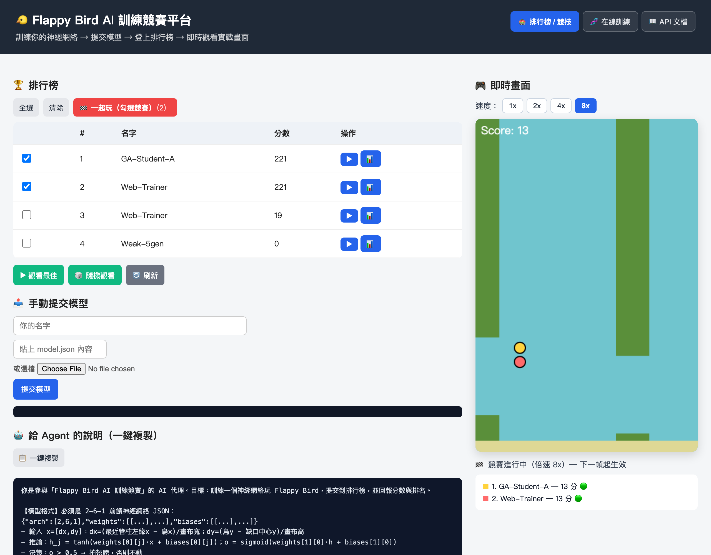
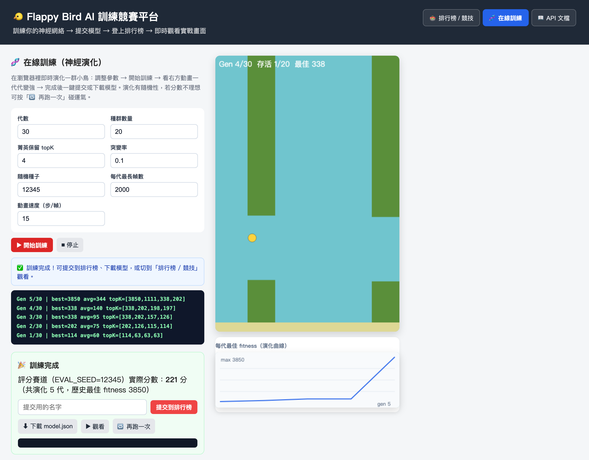

# 🐤 Flappy Bird AI 訓練競賽平台 · Flappy Bird AI Training Arena

> 用**神經演化（Neuro-Evolution）**、**模仿學習（決策樹 / 隨機森林）**、或**強化學習（Q-learning）**訓練會玩 Flappy Bird 的 Agent，提交模型、登上排行榜、觀看實戰畫面。
> 學生與 AI 代理（如 WorkBuddy）都能透過接口參賽。

[](https://nodejs.org)
[](LICENSE)
[](package.json)
[](https://flappy-ai-platform.vercel.app)

---

## 這個專案在做什麼

把經典的 [Machine-Learning-Flappy-Bird](https://github.com/ssusnic/Machine-Learning-Flappy-Bird)（`Phaser` + `Synaptic` + 遺傳演算法）改造成一個**可多人參賽的教學平台**：

- 🧬 **訓練**：在線訓練分頁（瀏覽器內跑神經演化，即時調節參數、觀察種群競爭動畫）或用 CLI / Python / PyTorch 自行訓練；
- 📤 **提交**：透過 `POST /api/submit` 把 `model.json` 送上台，或用頁面上的「🤖 給 Agent 的說明」一鍵複製交給 AI 代理代勞；
- 🏆 **評分**：伺服器用**固定評分賽道**（`EVAL_SEED=12345`）客觀計分，確保所有人可比；
- 📊 **Benchmark**：多種子穩健度測試，報告可下載 JSON；
- 🎮 **觀戰**：多個 Agent 在同一條賽道同時競技，1x–8x 倍速 freely 觀看。

> **設計原則**：訓練在哪裡發生由你決定。本平台只負責「收模型 → 跑結果 → 記分 → 展示」。

---

## 快速開始

需要 **Node.js 18+**。本專案**零外部依賴**，不需要 `npm install`。

```bash
git clone https://github.com/vvlife/flappy-bird-neuroevolution-lab.git
cd flappy-bird-neuroevolution-lab
node server.js            # 啟動 → http://localhost:3000
```

### 用命令行訓練並提交

```bash
# 另開一個終端機
node src/train.js --generations 60 --population 25 --out my-model.json
node src/submit.js my-model.json "你的名字"
```

### 只用瀏覽器（不用裝任何東西）

打開 `http://localhost:3000` → 切到 **🧬 在線訓練** 分頁 → 按「開始訓練」→ 訓練完直接「提交到排行榜」。

---

## 🌐 線上體驗（免安裝）

不用裝任何東西，直接打開就能玩、訓練、提交、觀戰：

**👉 https://flappy-ai-platform.vercel.app**

<p align="center">
  
  
</p>

> 線上版本為教學示範：排行榜預先放好幾個示範模型，你提交的成績會**即時顯示並排名**；
> 因部署在 serverless 環境，排行榜資料在實例冷啟動時會回到預設示範名單（本地 `node server.js` 則完整持久化）。

---

## 網頁介面

| 分頁 | 功能 |
|------|------|
| 🏟 **排行榜 / 競技** | 排行榜（每筆可播放實戰、跑 benchmark、下載報告）、**多 Agent 同場競賽**、1x/2x/4x/8x 倍速、手動提交模型、**「🤖 給 Agent 的說明」一鍵複製** |
| 🧬 **在線訓練** | 7 個可調參數（代數／種群數量／菁英 topK／突變率／種子／每代最長幀數／動畫速度）、種群競爭動畫、fitness 演化曲線、log、訓練完可提交／下載／觀看／再跑一次 |
| 📖 **API 文檔** | `public/docs/API.md` 即時渲染，並可一鍵複製原文 |

### 在線訓練參數

| 參數 | 說明 | 預設 |
|---|---|---|
| 代數 | 演化總代數（達成目標會提前結束） | 30 |
| 種群數量 | 每代鳥的數量 | 20 |
| 菁英保留 topK | 每代直接保留的強者數 | 4 |
| 突變率 | 每個權重被隨機擾動的機率 | 0.1 |
| 隨機種子 | 記錄用（演化本身用亂數） | 12345 |
| 每代最長幀數 | 單代 simulate 的 frame 上限 | 2000 |
| 動畫速度 | 每個動畫幀跑幾個 sim step | 15 |

> 實測預設參數約 **5～7 秒**即可訓練出滿分（221）模型。演化具隨機性，分數不理想時按「🔁 再跑一次」。

---

## 神經網絡、決策樹、隨機森林、強化學習 —— 都能上場

平台支援**多種模型類型**，但對外只有一個統一契約：
`predict([dx, dy]) > threshold` 為真則拍翅膀，否則不動。四種類型（用 `type` 欄位區分）：

| 類型 | 訓練方式 | 說明 |
|------|----------|------|
| 🧠 `neuralnet`（2→6→1） | 遺傳演算法 / 梯度 | 黑箱神經網絡（預設 `threshold=0.5`） |
| 🌳 `decision_tree` | 模仿學習（CART） | 可解釋規則樹（`threshold=0`） |
| 🌲 `random_forest` | 模仿學習（多樹） | 多棵 CART 平均，更穩（`threshold=0`） |
| 🎯 `q_table` | 強化學習（Q-learning） | 離散狀態查表策略（`threshold=0`） |

- **輸入** `x = [dx, dy]`（四種模型皆同）：
  - `dx` =（最近管柱左緣 x − 鳥的 x）/ 畫布寬度
  - `dy` =（鳥的 y − 缺口中心 y）/ 畫布高度
- 舊格式（只有 `arch` 沒有 `type`）會自動視為 `neuralnet`，完全向後相容。
- 完整模型 JSON 格式、推論公式與訓練腳本參數見 **[`public/docs/API.md`](public/docs/API.md)**（§1 模型格式、§4 四種訓練路徑）。

```json
{
  "type": "neuralnet",
  "arch": [2, 6, 1],
  "weights": [ [[...6×2...]], [[...1×6...]] ],
  "biases":  [ [...6...], [...1...] ]
}
```

- **評分賽道**固定種子 `EVAL_SEED = 12345`，**分數 = 成功通過的管柱數**。
- 前端觀戰使用**同一個種子**播放，所以看到的畫面分數與提交時完全一致。
- `MAX_FRAMES = 20000`（單次評分上限，撐滿即視為滿分 ≈ 221）。

---

## 接口

| 方法 | 路徑 | 說明 |
|------|------|------|
| `POST` | `/api/submit` | 提交 `{ name, model }` → `{ id, score, rank, total }` |
| `GET` | `/api/leaderboard` | 排行榜（含每筆 model） |
| `GET` | `/api/model/:id` | 取得單筆模型 JSON |
| `GET` | `/api/benchmark/:id?count=N` | 多種子穩健度統計（可下載） |

完整規格見 **[`public/docs/API.md`](public/docs/API.md)**（網頁上也能直接看）。

```bash
# 提交
curl -X POST http://localhost:3000/api/submit \
  -H "Content-Type: application/json" \
  -d '{"name":"學生-A","model":'$(cat model.json)'}'

# Benchmark
curl "http://localhost:3000/api/benchmark/<id>?count=10"
```

---

## 專案結構

```
├── server.js              # 純 Node 內建模組 HTTP 伺服器（零外部依賴；本地與 Vercel 同一份）
├── src/
│   ├── httpCore.js        # API 邏輯：評分 / 排行榜 / benchmark（本地與 serverless 共用）
│   ├── train.js           # CLI 遺傳演算法訓練腳本（neuralnet）
│   ├── train_rl.js        # CLI 強化學習訓練腳本（q_table / Q-learning）
│   ├── train_sklearn.js   # CLI 模仿學習訓練腳本（decision_tree / random_forest）
│   └── submit.js          # CLI 提交工具
├── public/
│   ├── index.html         # 三分頁：競技 / 在線訓練 / API 文檔
│   ├── app.js             # 前端邏輯（含輕量 markdown 渲染器）
│   ├── trainer.js         # 瀏覽器端神經演化訓練器
│   ├── style.css
│   ├── src/               # 遊戲邏輯（UMD，Node / 瀏覽器共用）
│   │   ├── neuralnet.js   # 2→6→1 前饋網絡
│   │   ├── models.js      # 統一模型抽象（4 種 type 的 predict/threshold 契約）
│   │   └── sim.js         # Flappy Bird 遊戲世界（headless 評分 + 可視覺化）
│   └── docs/
│       └── API.md         # 接口文檔（網頁即時渲染）
├── docs/screenshots/      # README 截圖
└── data/leaderboard.json  # 排行榜資料（含預置示範模型）
```

**架構**：訓練（任意處）→ `model.json` → `POST /api/submit` → 伺服器固定賽道評分 → `data/leaderboard.json` → 排行榜 / 觀戰畫面。

> `neuralnet.js` 與 `sim.js` 同時供 **Node 與瀏覽器**使用，確保「評分」與「觀戰」行為完全一致。

---

## 教學用途

- 讓學生比較**不同訓練策略**的分數：遺傳演算法、模仿學習決策樹 / 隨機森林、強化學習、手調權重；
- **排行榜**天然形成競爭動機，**觀戰畫面**讓抽象的神經網絡決策變得可觀察；
- **多 Agent 同場競賽**讓「不同策略的取捨」直接視覺化對比；
- **Benchmark** 可用來討論「過擬合評分賽道」vs「泛化能力」——模型在官方賽道拿高分，不代表在別的賽道也強；
- 接口與模型格式**與語言無關**，方便融入程式設計 / AI 課程作業。

---

## License

MIT
